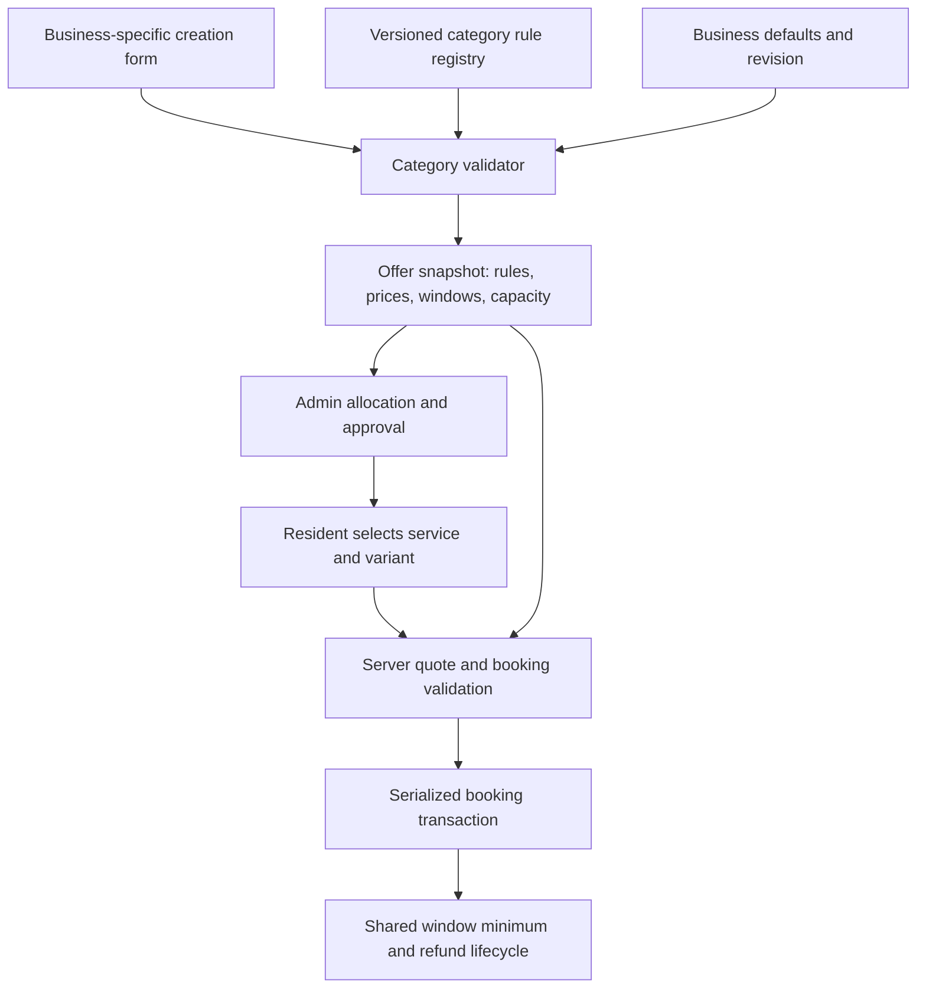

# Category rules and business-specific offers

## Why separate rules?
Food and car cleaning share approval, deposits, capacity and refunds, but they count different things and need different booking details. Category-specific validation and quote calculation belong behind one shared booking API, rather than separate payment/lifecycle implementations.

## Implemented layers
- `lib/serviceRules.mjs`: category contracts and rule versions; vehicle types; server-side vehicle quoting, duplicate-car and crew-minute checks.
- `lib/car.mjs`: Wecare onboarding seed, car-specific offer validation, atomic multi-community offer creation and validated business defaults.
- `lib/food.mjs`: food-specific package and offer creation. New food offers now carry a food rule snapshot.
- `lib/slotLifecycle.mjs`: shared counting, provisional confirmation and independent window expiry/refunds. Extracted from the food implementation and used for both food and cars.
- `lib/domain.mjs`: shared booking, cancellation, payment arithmetic and lifecycle entry point. It stores the server-derived quote and vehicle details with each booking.
- `BusinessModule`: exposes Service rules; future offers use new defaults. Existing snapshots are not rewritten.
- `supabase/004_service_rules_and_vehicles.sql`: category version table, business settings, offer snapshots and vehicle booking fields; unique active vehicle/date constraint; a service-only vehicle-payment RPC. SQL stores money in minor units.

## Rules that differ
| Setting | Food | Car cleaning |
|---|---|---|
| Count | Paid portions | Paid cars |
| Quantity | Multiple portions | One vehicle per reservation |
| Minimum | Each community window | Each community window, all vehicle types combined |
| Price | Per portion | Per selected vehicle type |
| Details | Package and allergens | Vehicle type, registration identifier, parking location |
| Capacity | Portion limit | Car limit plus team time |
| Failure | Refund failed window | Refund failed window |

Admin approval and daily community/category exclusivity remain platform rules. A business cannot bypass them with defaults. Generic offer creation rejects food and car packages so category validation cannot be bypassed through the old form. Legacy demo offers keep their original behavior.

## Wecare example and assumptions
Wecare Car Cleaning serves the Wasl Village demo. Its seed draft uses the next Friday, 13:00–15:00, minimum 10 cars, maximum 12, with three parallel teams. Sedan is AED 15. Editable sample SUV/crossover prices are AED 20/AED 18. Each uses a sample AED 5 deposit. Estimated durations are 20/30/25 minutes respectively. These are planning assumptions, not verified operating rates.

Maximum safe cars = parallel teams × floor(window minutes / slowest enabled vehicle's minutes). With 3 teams, 120 minutes and 30 minutes for an SUV, the safe maximum is 12. This conservative limit remains feasible if every customer selects an SUV. Booking also tracks used crew minutes and enforces the car-count limit.

Ten cars can be any mix of enabled vehicle types. Each pays its vehicle-specific price; there is no automatic price increase if demand is low. Below minimum at cutoff means cancellation/refund for that window. Each community needs its own crew allocation; the UI says teams are per community. Cross-community fleet/crew assignment is not implemented.

A window is an arrival/service window, not a guaranteed exact start appointment. Cars are queued by the on-site team. The business specifies inclusions/exclusions, site access and water arrangements. Private credentials and real plates are unnecessary in the demo; use sample identifiers.

## Safe future changes
Change category semantics by adding a new rule version and adapting its validator/quote function. Do not change the meaning of existing version numbers. Change business defaults through Service rules; a revision is copied into new offers. Offer vehicle prices and durations are set explicitly before submission. Approved requests cannot be edited. Bookings retain price, deposit, vehicle and duration snapshots.

New categories can add an adapter and UI while reusing the shared state machine. The current registry actively supports food and cars; other legacy service categories retain the earlier generic workflow. There is no arbitrary rule-code editor or live migration of existing bookings.

## Production boundary
The running app remains a single-process local demo with simulated authentication and payments. Database migrations are supplied separately; they do not connect the application to Supabase. A hosted adapter must validate and snapshot vehicle variants, convert all prices to minor units, enforce approval-time capacity, manage permissions and call payment RPCs only after provider verification. Real payment reconciliation, team dispatch, no-show penalties, weather rescheduling and invoices are not implemented.
